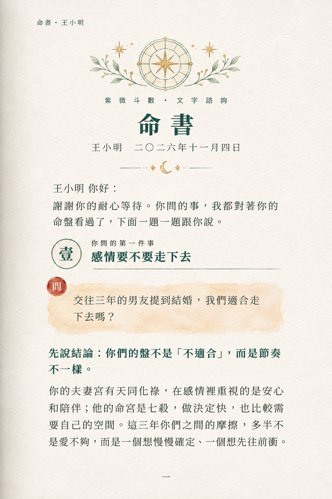
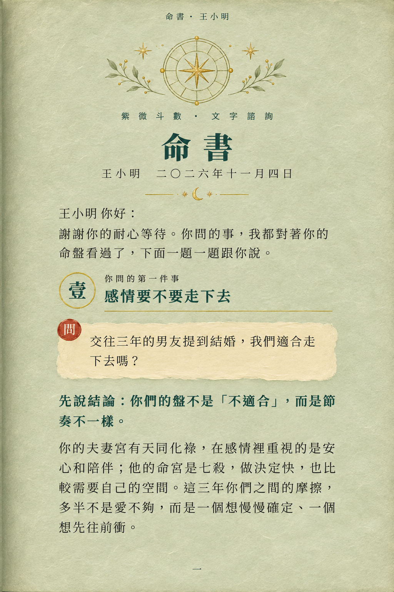
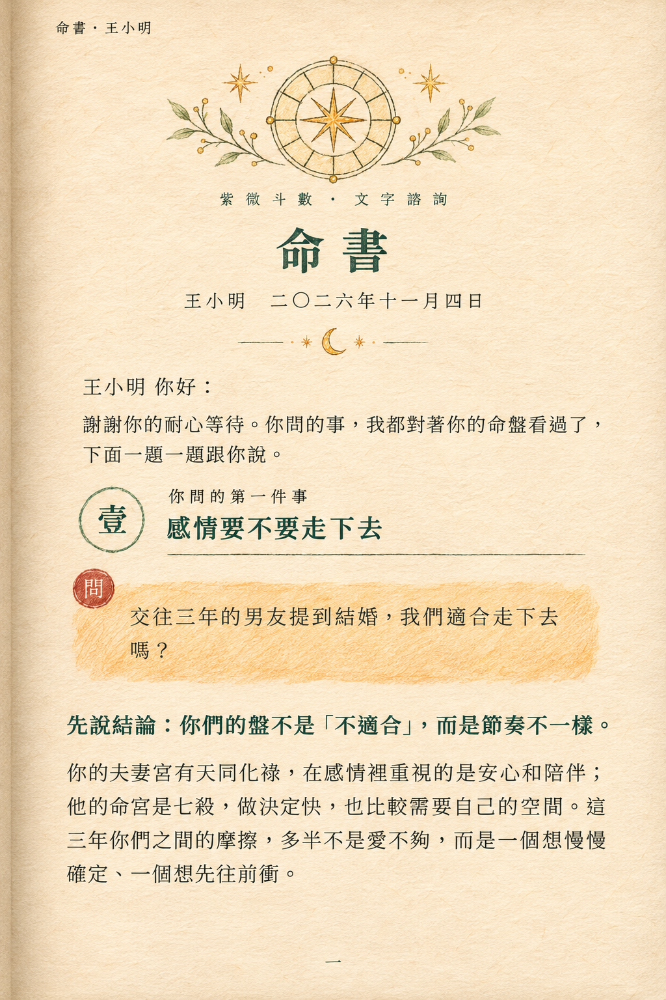

# Codex 製作與審稿交接｜2026-11-07

供使用者與 Claude 接續討論。狀態：風格草稿，未定稿。使用者已授權生成並推送本分支。

依據：提示詞.md（blob f83dcd0e805310da385fd741c7d04c4c138f83b2）與兩張 reference-live 圖。使用內建 image_gen，每版獨立生成第一頁；第二頁依原規格等待選定風格。

## 圖片

### A-冷白水彩-page1.png



### B-鼠尾草綠水粉-page1.png



### C-色鉛筆-page1.png



## 初步審稿

- A：冷白紙與透明淡彩，最清爽。
- B：綠紙、奶油問題塊與金線，品牌色最突出。
- C：暖紙、色鉛筆排線與鋼筆感，手作感最強。
- 三張均保留書眉、羅盤、命書標題、姓名日期、問候、章節壹、問題與兩段正文、頁碼；正文已完整放入單頁。
- 已知差異：生成圖沿用參考圖紅色「問」章，與「暗紅只用在羊印」不一致；未呈現羊印。參考截圖本身沒有可辨識羊印，請下一輪提供既有羊印圖檔與第一頁位置，不要憑空建立品牌印章。
- 三版行寬、書眉位置與換行不完全一致；若要精準材質比較，定稿時需統一。
- C 的色鉛筆問題區偏亮橘，可依使用者意見再降低飽和度。
- 目前為 raster 概念樣張，非可編輯或印刷定稿。正式製作應另排文字並逐字校對。

## 請 Claude 接續回覆

可在本分支另增 review-claude.md：記錄 A/B/C 評語、使用者偏好、羊印資產路徑及下一輪修訂項目。請保留本次圖片，以版本檔名新增修訂。這是檔案交接，尚未收到 Claude 回覆。

## 實際生成提示

### A-冷白水彩-page1.png

```text
Generate version A only. Use case: stylized-concept. The two attached images are layout and motif REFERENCES, not text sources. Produce a complete single page with ALL the exact specified first-page copy, NOT a screenshot crop. Retain the reference's element order, reduce compass size to fit all text comfortably with margins. No second-page content. No extra copy. Render Traditional Chinese accurately. Follow this specification:
請參考參考圖（目前線上的「命書」內頁），畫一張「書的單頁」。

要求：版面與元素種類完全沿用參考圖：頁首的羅盤插畫、「命書」標題、章節圓章、問題水彩塊、星月分隔、羊印。不要換版面、不要增加新元素。只改「材質與畫法」，我會在下面指定。

這是一本書的其中一頁，不是海報、不是社群貼文：
- 比例 2:3（1024×1536），單頁。
- 靠書脊的一側（左側）有淡淡的裝訂陰影，紙面有極輕微的弧度與柔和的邊緣陰影，像攤開的書頁。不要外框、不要邊框。
- 頁首最上方有一行很小的書眉，頁尾中間有一個很小的頁碼，像書本的排版。
- 排版像書：單欄、文字左對齊、行距寬、四周留白大。標題不要放大成海報字，章節標題大小適中。
- 不要出現：膠帶、貼紙、螢光筆、緞帶橫幅、超大毛筆標題、星星項目符號、發光粒子。

請「完全照下列文字」寫在頁面上，不要增加、不要改寫、不要編造其他文案：

書眉：命書・王小明
頁首小字：紫微斗數・文字諮詢
標題：命書
姓名日期：王小明　二〇二六年十一月四日
問候：王小明 你好：
謝謝你的耐心等待。你問的事，我都對著你的命盤看過了，下面一題一題跟你說。
章節圓章：壹
章節小字：你問的第一件事
章節標題：感情要不要走下去
問題框：交往三年的男友提到結婚，我們適合走下去嗎？
內文第一段（略粗）：先說結論：你們的盤不是「不適合」，而是節奏不一樣。
內文第二段：你的夫妻宮有天同化祿，在感情裡重視的是安心和陪伴；他的命宮是七殺，做決定快，也比較需要自己的空間。這三年你們之間的摩擦，多半不是愛不夠，而是一個想慢慢確定、一個想先往前衝。
頁碼：一

【材質與畫法】
- 紙：冷調的米白色冷壓水彩紙，紙面有明顯但細緻的顆粒紋，整體比參考圖更乾淨、更明亮，不要偏黃橘。
- 畫法：透明水彩淡彩加極細的深青綠墨線，水彩色塊薄、通透、邊緣有自然的水痕與留白，不要塗抹感、不要條紋。
- 問題框：淡赭色水彩塊，邊緣暈開，顏色比參考圖淡。
- 色彩：米白、深青綠 #1F4C44、淡赭、淡鼠尾草綠，暗紅只用在羊印。整體清爽、安靜。

```

### B-鼠尾草綠水粉-page1.png

```text
Generate version B only. Use case: stylized-concept. The two attached images are layout and motif REFERENCES, not text sources. Produce a complete single page with ALL the exact specified first-page copy, NOT a screenshot crop. Retain the reference's element order, reduce compass size to fit all text comfortably with margins. No second-page content. No extra copy. Render Traditional Chinese accurately. Follow this specification:
請參考參考圖（目前線上的「命書」內頁），畫一張「書的單頁」。

要求：版面與元素種類完全沿用參考圖：頁首的羅盤插畫、「命書」標題、章節圓章、問題水彩塊、星月分隔、羊印。不要換版面、不要增加新元素。只改「材質與畫法」，我會在下面指定。

這是一本書的其中一頁，不是海報、不是社群貼文：
- 比例 2:3（1024×1536），單頁。
- 靠書脊的一側（左側）有淡淡的裝訂陰影，紙面有極輕微的弧度與柔和的邊緣陰影，像攤開的書頁。不要外框、不要邊框。
- 頁首最上方有一行很小的書眉，頁尾中間有一個很小的頁碼，像書本的排版。
- 排版像書：單欄、文字左對齊、行距寬、四周留白大。標題不要放大成海報字，章節標題大小適中。
- 不要出現：膠帶、貼紙、螢光筆、緞帶橫幅、超大毛筆標題、星星項目符號、發光粒子。

請「完全照下列文字」寫在頁面上，不要增加、不要改寫、不要編造其他文案：

書眉：命書・王小明
頁首小字：紫微斗數・文字諮詢
標題：命書
姓名日期：王小明　二〇二六年十一月四日
問候：王小明 你好：
謝謝你的耐心等待。你問的事，我都對著你的命盤看過了，下面一題一題跟你說。
章節圓章：壹
章節小字：你問的第一件事
章節標題：感情要不要走下去
問題框：交往三年的男友提到結婚，我們適合走下去嗎？
內文第一段（略粗）：先說結論：你們的盤不是「不適合」，而是節奏不一樣。
內文第二段：你的夫妻宮有天同化祿，在感情裡重視的是安心和陪伴；他的命宮是七殺，做決定快，也比較需要自己的空間。這三年你們之間的摩擦，多半不是愛不夠，而是一個想慢慢確定、一個想先往前衝。
頁碼：一

【材質與畫法】
- 紙：淡鼠尾草綠色的手工紙，帶細纖維紋與微微的雲紋，像有色的書頁，不是白紙。
- 畫法：不透明水粉（啞光）畫出的色塊與插畫，邊緣乾淨有手作的不規則，少量金色墨水作為點綴線條（羅盤、星月、分隔線、章節圓章的細框）。
- 問題框：略亮的奶油色水粉塊，像貼在書頁上的紙片，不是水彩暈染。
- 色彩：鼠尾草綠、奶油白、深青綠 #1F4C44、暖金，暗紅只用在羊印。整體沉穩、有質感，不要金屬反光感。

```

### C-色鉛筆-page1.png

```text
Generate version C only. Use case: stylized-concept. The two attached images are layout and motif REFERENCES, not text sources. Produce a complete single page with ALL the exact specified first-page copy, NOT a screenshot crop. Retain the reference's element order, reduce compass size to fit all text comfortably with margins. No second-page content. No extra copy. Render Traditional Chinese accurately. Follow this specification:
請參考參考圖（目前線上的「命書」內頁），畫一張「書的單頁」。

要求：版面與元素種類完全沿用參考圖：頁首的羅盤插畫、「命書」標題、章節圓章、問題水彩塊、星月分隔、羊印。不要換版面、不要增加新元素。只改「材質與畫法」，我會在下面指定。

這是一本書的其中一頁，不是海報、不是社群貼文：
- 比例 2:3（1024×1536），單頁。
- 靠書脊的一側（左側）有淡淡的裝訂陰影，紙面有極輕微的弧度與柔和的邊緣陰影，像攤開的書頁。不要外框、不要邊框。
- 頁首最上方有一行很小的書眉，頁尾中間有一個很小的頁碼，像書本的排版。
- 排版像書：單欄、文字左對齊、行距寬、四周留白大。標題不要放大成海報字，章節標題大小適中。
- 不要出現：膠帶、貼紙、螢光筆、緞帶橫幅、超大毛筆標題、星星項目符號、發光粒子。

請「完全照下列文字」寫在頁面上，不要增加、不要改寫、不要編造其他文案：

書眉：命書・王小明
頁首小字：紫微斗數・文字諮詢
標題：命書
姓名日期：王小明　二〇二六年十一月四日
問候：王小明 你好：
謝謝你的耐心等待。你問的事，我都對著你的命盤看過了，下面一題一題跟你說。
章節圓章：壹
章節小字：你問的第一件事
章節標題：感情要不要走下去
問題框：交往三年的男友提到結婚，我們適合走下去嗎？
內文第一段（略粗）：先說結論：你們的盤不是「不適合」，而是節奏不一樣。
內文第二段：你的夫妻宮有天同化祿，在感情裡重視的是安心和陪伴；他的命宮是七殺，做決定快，也比較需要自己的空間。這三年你們之間的摩擦，多半不是愛不夠，而是一個想慢慢確定、一個想先往前衝。
頁碼：一

【材質與畫法】
- 紙：暖奶油色的手工纖維紙，帶可見的纖維與輕微的凹凸，像筆記本內頁。
- 畫法：用色鉛筆上色，可以看見筆觸、交叉排線與輕微的顆粒；線條用鋼筆，細而有手寫感，略有不完美。水彩塊全部改成色鉛筆塗出的色塊，邊緣有筆觸感。
- 羅盤與星月：鋼筆線稿加色鉛筆淡塗。
- 色彩：奶油白、深青綠 #1F4C44、淡橘、淡鼠尾草綠，暗紅只用在羊印。

```

