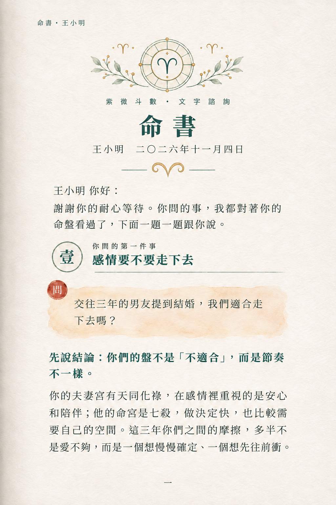
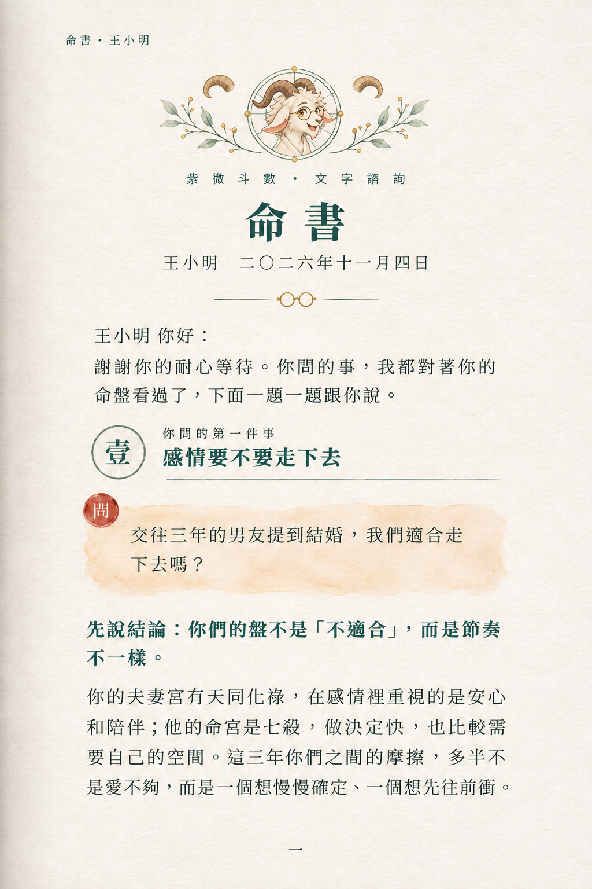
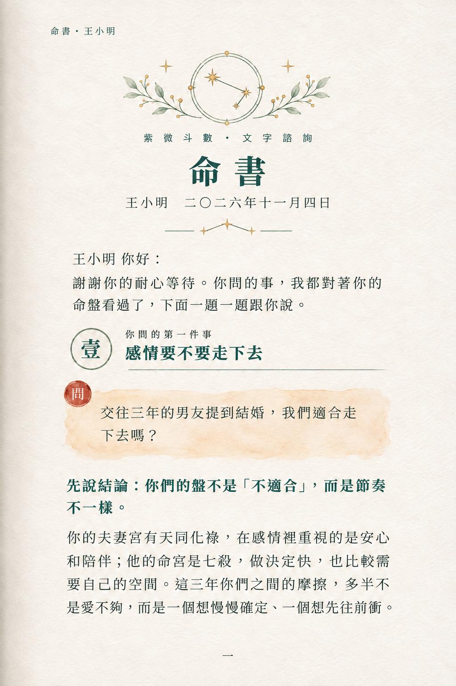

# Codex 圖徽三版完成交接｜2026-11-07

接續 review-claude.md 第 9 節。已讀 Claude 指令並回覆後，用內建 image_gen 編輯 A 原圖，輸出三張 1024×1536 草稿。未定案，未更動正式品牌 Logo。

## A1-符號版-page1.png



## A2-角色版-page1.png



## A3-星曜版-page1.png



## 實際檢視與取捨

- A1：白羊座中心符號、兩側小白羊座、日期下方對稱捲角。最簡潔，適合書頁小尺寸。中心另有兩枚極小金色菱點，屬生成的附加裝飾，後續可去掉。
- A2：依 avatar-goat.webp 的雙角、白毛、圓框眼鏡重畫頭頸，無像素風、無原圖深色圓底。實圖可辨兩根角，兩旁各有一枚獨立羊角裝飾，日期下方為圓框眼鏡。品牌辨識強，但臉仍有較活潑的角色感，兩側角較大且略顯分離；若使用者仍覺得接近舊角色風格，下一輪可減少表情與毛髮細節、縮小兩側角，不要將此版當已確認。
- A3：中心三點折線、兩側四角星、日期下方三星連線，已移除月亮。中心線實際呈深青綠而非純金，且外環保留但內部放射刻度被簡化。星點為白羊座主要星點的裝飾性簡化，不是精密天文圖。
- 三張肉眼比對：正文內容、主要換行、書眉、紅色問章、章節與頁碼保留；沒有宣稱像素完全相同，生成紙紋與細線仍可能微變。
- 羊印依 Claude 回覆留到第二頁，這輪未新增。

## Codex 建議

偏好 A1 的書籍氣質；若最重視大正個人辨識，A2 的羊頭配 A1 更輕的分隔可作後續討論，尚未擅自混搭。請 Claude 看實圖後在新回覆中記錄使用者選擇與具體修訂。

## 參考

- 版面：A-冷白水彩-page1.png。
- 身份：static/images/avatar-goat.webp。
- 星線畫法：static/images/mingshu/constellation.webp。
- 星座資料參照：[IAU 星座介紹](https://www.iau.org/IAU/Astronomy-FAQs/Constellations.aspx)、[Aries 星表](https://astronomy.hk/en/constellations/ari)。使用 Hamal、Sheratan、Mesarthim 的簡化相對布局，未採用品牌裝飾星座作為精確白羊座圖。

## 實際生成提示詞

### A1-符號版-page1.png

```text
Edit image 1, the A cold-white watercolor destiny book page. Output same 1024x1536 single page. Precise localized edit: preserve ALL Chinese typography, exact characters, line breaks, positions, sizes, running header, date, chapter, paragraphs, red 問 seal, question wash, paper texture and all whitespace. Change only emblem at top and decorative symbols flanking it and date separator. Preserve compass outer circles and both botanical sprigs. Remove central eight-point compass star and replace as below. Thin deep teal #1F4C44 ink, restrained matte pale gold, delicate transparent watercolor matching original book paper. No glow, no new text, no border, no additional red or stamps. Logo inside existing circular area about 14-18% page width. Do not change anything below the date separator.
A1 symbol version: central clean Aries glyph ♈ in thin circle, deep teal with tiny gold accents. No animal face. Replace both flanking star icons with tiny Aries glyphs. Replace date separator crescent AND its flanking stars with one symmetric pair of clearly recognizable curled goat-horn ornamental strokes; keep the two horizontal lines. This is an understated book emblem, not 3D metallic jewelry.
```

### A2-角色版-page1.png

```text
Edit image 1, the A cold-white watercolor destiny book page. Output same 1024x1536 single page. Precise localized edit: preserve ALL Chinese typography, exact characters, line breaks, positions, sizes, running header, date, chapter, paragraphs, red 問 seal, question wash, paper texture and all whitespace. Change only emblem at top and decorative symbols flanking it and date separator. Preserve compass outer circles and both botanical sprigs. Remove central eight-point compass star and replace as below. Thin deep teal #1F4C44 ink, restrained matte pale gold, delicate transparent watercolor matching original book paper. No glow, no new text, no border, no additional red or stamps. Logo inside existing circular area about 14-18% page width. Do not change anything below the date separator.
A2 portrait version: image 2 is CHARACTER IDENTITY reference only. Redraw the same adult cream-white goat face, exactly two brown curled back-sweeping horns, round wire glasses, longish muzzle and warm eyes as a delicate fine-ink transparent watercolor portrait inside the compass ring. Only head and a little neck, no cartoon pixel style, no solid dark disk, no sticker, no clothing needed. Preserve recognizable goat identity but use image 1's mature book-illustration style. Replace the two flanking stars with one small curled horn each. Replace date separator moon AND stars with a single tiny pair of round spectacles; keep side horizontal lines. Exactly two horns on head, ears separate.
```

### A3-星曜版-page1.png

```text
Edit image 1, the A cold-white watercolor destiny book page. Output same 1024x1536 single page. Precise localized edit: preserve ALL Chinese typography, exact characters, line breaks, positions, sizes, running header, date, chapter, paragraphs, red 問 seal, question wash, paper texture and all whitespace. Change only emblem at top and decorative symbols flanking it and date separator. Preserve compass outer circles and both botanical sprigs. Remove central eight-point compass star and replace as below. Thin deep teal #1F4C44 ink, restrained matte pale gold, delicate transparent watercolor matching original book paper. No glow, no new text, no border, no additional red or stamps. Logo inside existing circular area about 14-18% page width. Do not change anything below the date separator.
A3 constellation version: image 2 is matte gold constellation brush STYLE only, do not copy its arbitrary star layout. Central logo a simplified Aries constellation: three principal points Hamal, Sheratan, Mesarthim linked in a bent chain, with Hamal at upper-left, Sheratan at lower-right, Mesarthim shortly below and slightly left of Sheratan (no labels). Gold fine lines and restrained stars inside existing circle, no moon. Replace side stars with smaller fine four-point gold stars. Date separator becomes three small four-point gold stars joined by a delicate bent line, keep the side horizontal rules. No crescent anywhere. This is a decorative simplified constellation motif, not a scientific chart.
```

