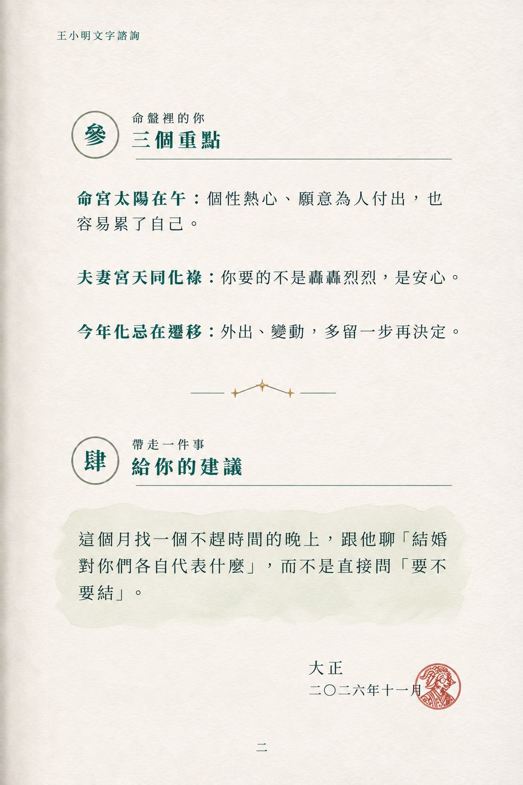
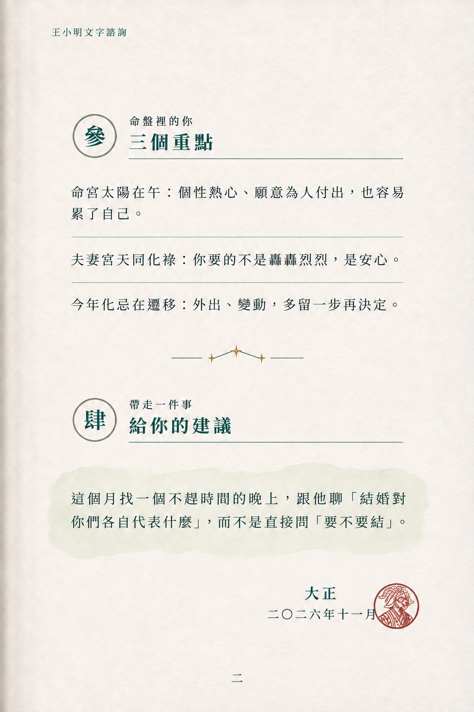
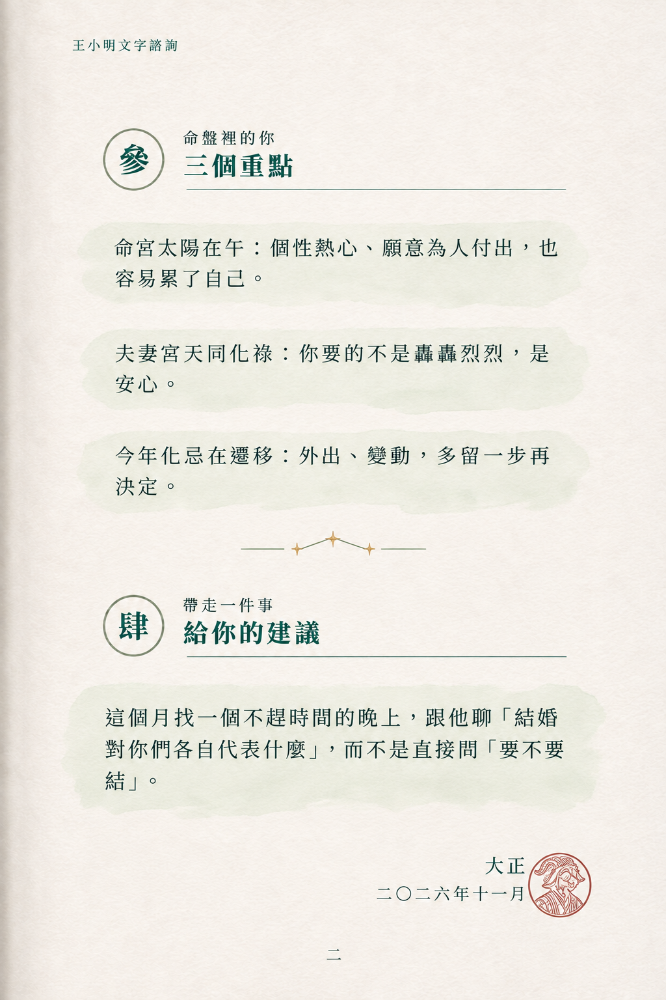

# 第二頁完成｜2026-11-07

已讀 Claude 的 V1 決定、手機長文與 Email 限制，並先在 page2-codex-plan-and-prompts.md 回覆；按使用者直接生成授權完成三個續頁草稿。三種重點區排法是 Codex 的比較方案，未聲稱 Claude 已回覆同意。

第一頁捲角版已由使用者明確確認。第二頁文案沿原 提示詞.md 的參、肆與落款，書眉用新版「王小明文字諮詢」。不編造貳章、不重複大型首屏圖徽。此為書頁視覺示意，不是已完成網頁、手機或 Email 實作。

## A3-V1-P2A-留白段落-page2.png



## A3-V1-P2B-細線分段-page2.png



## A3-V1-P2C-淡彩重點-page2.png



## 審稿結果

- P2A：留白加重點詞，與第一頁最連貫，Codex 首推。
- P2B：細線區分三段。生成後對建議句做了一次文字校正，採用校正後圖。
- P2C：三個淡鼠尾草水彩底，掃讀明確，但色塊偏多，建議區的焦點會較弱。
- 已按示範稿逐段視覺核對三個重點、建議句、書眉、參肆、落款日期與頁碼；未見文字增刪。最終仍應採可編輯文字排版，不以圖像稿當程式文字來源。
- 實際三版的章節高度、換行與落款位置有差異，未完全遵循同一網格；選定後需固定。
- 羊印以 seal-goat.webp 為生成參考，實際為模型重繪，存在角色線條差異，且多在日期旁／僅輕微相接，未完全達到「淡蓋日期、文字透出」要求。這是已知草稿偏差，不作正式品牌印章；定稿實作請直接引用原始透明羊印並控制透明度與位置。
- 沒有更動頭像徽章、第一頁、上線程式、Email 或開場動畫。

## 下一步供 Claude 討論

請比較 P2A/B/C 的閱讀層級，依使用者選擇定一種。網頁長捲保留章節結構，不必照圖片固定高度或把全文壓在 2:3 範圍；印刷頁碼與書眉僅在對應輸出使用。標題 clamp 與 Email 差異的具體回覆見 page2-codex-plan-and-prompts.md。

## 內建 image_gen 實際提示詞

### A3-V1-P2A-留白段落-page2.png

```text
Create a finished SECOND PAGE of the same elegant Traditional Chinese consultation booklet as reference 1. 1024x1536 portrait. Reference 1 is STYLE AND TYPOGRAPHY only, do NOT copy its page-one text or header emblem. Reference 2 is the exact existing brand goat seal design. Match cool off-white watercolor paper texture and faint left binding shadow, deep teal #1F4C44 Song/Ming serif typography, generous book margins, single-column left alignment. No big logo, no repeated main title or cover header, no face illustration except tiny seal. This page is chapters 參 and 肆. Running header at x110 y70, chapter 參 begins about y210, three key paragraphs from y340 to y680, subtle three-gold-star connected divider y760, chapter 肆 around y850, advice around y990-1190, signature at right around y1330, page number bottom y1470. Keep this grid, body text approx 30px, readable, spacious, natural wrapping at about 23 Chinese characters.
Exact Traditional Chinese text, labels below are instructions NOT printed:
running header「王小明文字諮詢」
chapter circle「參」
small eyebrow「命盤裡的你」
chapter title「三個重點」
paragraph 1「命宮太陽在午：個性熱心、願意為人付出，也容易累了自己。」
paragraph 2「夫妻宮天同化祿：你要的不是轟轟烈烈，是安心。」
paragraph 3「今年化忌在遷移：外出、變動，多留一步再決定。」
chapter circle「肆」
small eyebrow「帶走一件事」
chapter title「給你的建議」
advice EXACT「這個月找一個不趕時間的晚上，跟他聊「結婚對你們各自代表什麼」，而不是直接問「要不要結」。」
signature「大正」
signature date「二〇二六年十一月」
page number「二」
Use same thin circle chapter medallion and horizontal fine rule treatment as reference1. The advice has a very pale transparent sage watercolor wash with natural edges, no thick frame. Tiny dark red circular goat seal using reference2 exactly as closely as possible, about 80px diameter, applied lightly overlapping the right end of signature date, date must remain legible THROUGH stamp. No added seal lettering, no extra text anywhere. Only one stamp. No moon, foliage, star-shaped bullets, tape, stickers, cartoon new character, thick borders, bright colors. Text must be verbatim. Keep original goat seal's two horns and spectacles.
VERSION P2-A: Three key paragraphs directly on clean paper with generous vertical whitespace, no boxes, no bullets. Emphasize only the initial phrase before each colon using slightly heavier teal. Most restrained and booklike.
```

### A3-V1-P2B-細線分段-page2.png

```text
Create a finished SECOND PAGE of the same elegant Traditional Chinese consultation booklet as reference 1. 1024x1536 portrait. Reference 1 is STYLE AND TYPOGRAPHY only, do NOT copy its page-one text or header emblem. Reference 2 is the exact existing brand goat seal design. Match cool off-white watercolor paper texture and faint left binding shadow, deep teal #1F4C44 Song/Ming serif typography, generous book margins, single-column left alignment. No big logo, no repeated main title or cover header, no face illustration except tiny seal. This page is chapters 參 and 肆. Running header at x110 y70, chapter 參 begins about y210, three key paragraphs from y340 to y680, subtle three-gold-star connected divider y760, chapter 肆 around y850, advice around y990-1190, signature at right around y1330, page number bottom y1470. Keep this grid, body text approx 30px, readable, spacious, natural wrapping at about 23 Chinese characters.
Exact Traditional Chinese text, labels below are instructions NOT printed:
running header「王小明文字諮詢」
chapter circle「參」
small eyebrow「命盤裡的你」
chapter title「三個重點」
paragraph 1「命宮太陽在午：個性熱心、願意為人付出，也容易累了自己。」
paragraph 2「夫妻宮天同化祿：你要的不是轟轟烈烈，是安心。」
paragraph 3「今年化忌在遷移：外出、變動，多留一步再決定。」
chapter circle「肆」
small eyebrow「帶走一件事」
chapter title「給你的建議」
advice EXACT「這個月找一個不趕時間的晚上，跟他聊「結婚對你們各自代表什麼」，而不是直接問「要不要結」。」
signature「大正」
signature date「二〇二六年十一月」
page number「二」
Use same thin circle chapter medallion and horizontal fine rule treatment as reference1. The advice has a very pale transparent sage watercolor wash with natural edges, no thick frame. Tiny dark red circular goat seal using reference2 exactly as closely as possible, about 80px diameter, applied lightly overlapping the right end of signature date, date must remain legible THROUGH stamp. No added seal lettering, no extra text anywhere. Only one stamp. No moon, foliage, star-shaped bullets, tape, stickers, cartoon new character, thick borders, bright colors. Text must be verbatim. Keep original goat seal's two horns and spectacles.
VERSION P2-B: Same exact layout and text but between the three key paragraphs add very fine pale teal horizontal dividing rules, inset to text width. No boxes, no bullets, no background behind these paragraphs.
```

### A3-V1-P2C-淡彩重點-page2.png

```text
Create a finished SECOND PAGE of the same elegant Traditional Chinese consultation booklet as reference 1. 1024x1536 portrait. Reference 1 is STYLE AND TYPOGRAPHY only, do NOT copy its page-one text or header emblem. Reference 2 is the exact existing brand goat seal design. Match cool off-white watercolor paper texture and faint left binding shadow, deep teal #1F4C44 Song/Ming serif typography, generous book margins, single-column left alignment. No big logo, no repeated main title or cover header, no face illustration except tiny seal. This page is chapters 參 and 肆. Running header at x110 y70, chapter 參 begins about y210, three key paragraphs from y340 to y680, subtle three-gold-star connected divider y760, chapter 肆 around y850, advice around y990-1190, signature at right around y1330, page number bottom y1470. Keep this grid, body text approx 30px, readable, spacious, natural wrapping at about 23 Chinese characters.
Exact Traditional Chinese text, labels below are instructions NOT printed:
running header「王小明文字諮詢」
chapter circle「參」
small eyebrow「命盤裡的你」
chapter title「三個重點」
paragraph 1「命宮太陽在午：個性熱心、願意為人付出，也容易累了自己。」
paragraph 2「夫妻宮天同化祿：你要的不是轟轟烈烈，是安心。」
paragraph 3「今年化忌在遷移：外出、變動，多留一步再決定。」
chapter circle「肆」
small eyebrow「帶走一件事」
chapter title「給你的建議」
advice EXACT「這個月找一個不趕時間的晚上，跟他聊「結婚對你們各自代表什麼」，而不是直接問「要不要結」。」
signature「大正」
signature date「二〇二六年十一月」
page number「二」
Use same thin circle chapter medallion and horizontal fine rule treatment as reference1. The advice has a very pale transparent sage watercolor wash with natural edges, no thick frame. Tiny dark red circular goat seal using reference2 exactly as closely as possible, about 80px diameter, applied lightly overlapping the right end of signature date, date must remain legible THROUGH stamp. No added seal lettering, no extra text anywhere. Only one stamp. No moon, foliage, star-shaped bullets, tape, stickers, cartoon new character, thick borders, bright colors. Text must be verbatim. Keep original goat seal's two horns and spectacles.
VERSION P2-C: Same exact layout and text but each of three key paragraphs sits on its own extremely faint transparent sage watercolor brush wash, 5% tint, softly irregular edges, separated with white space. No hard card edges, no shadows, no border, no bullets.
```

