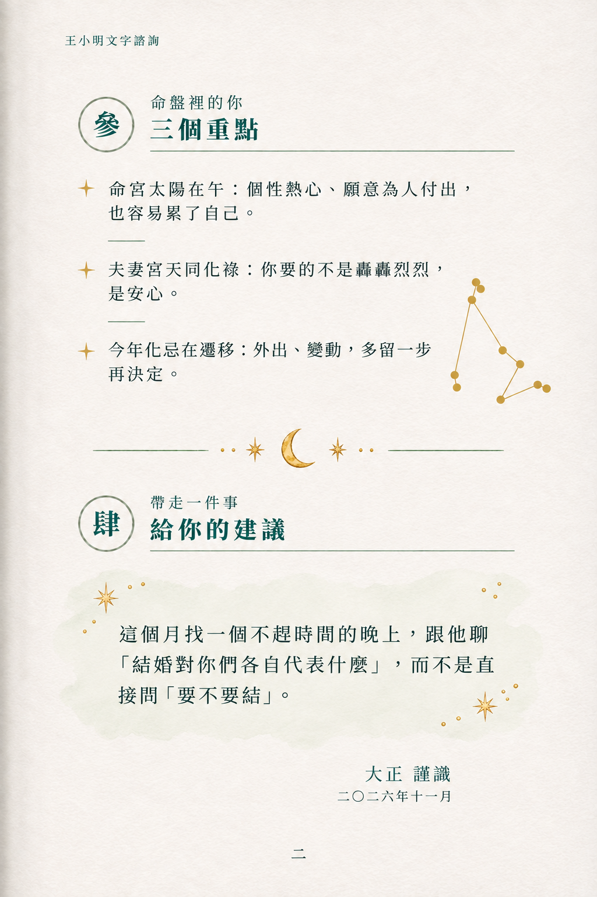
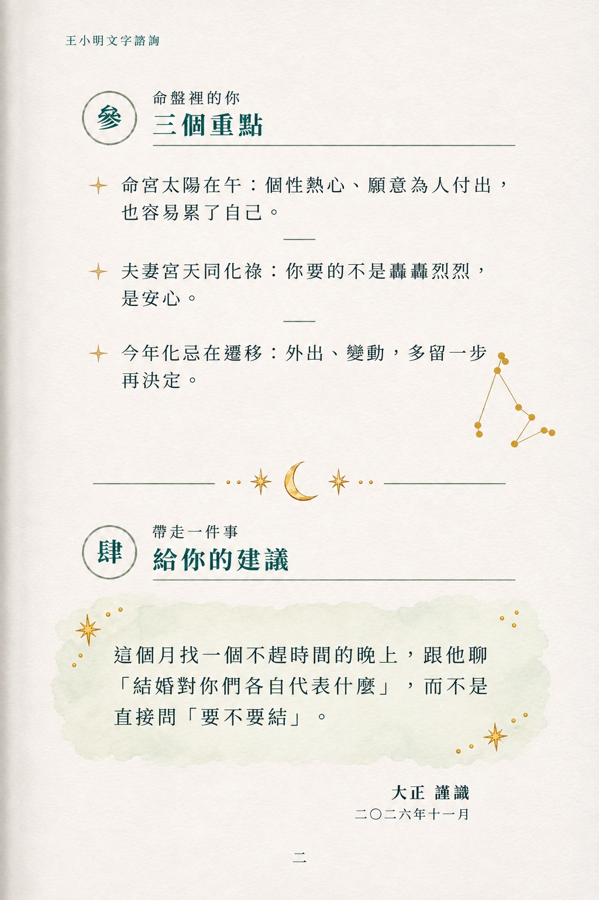
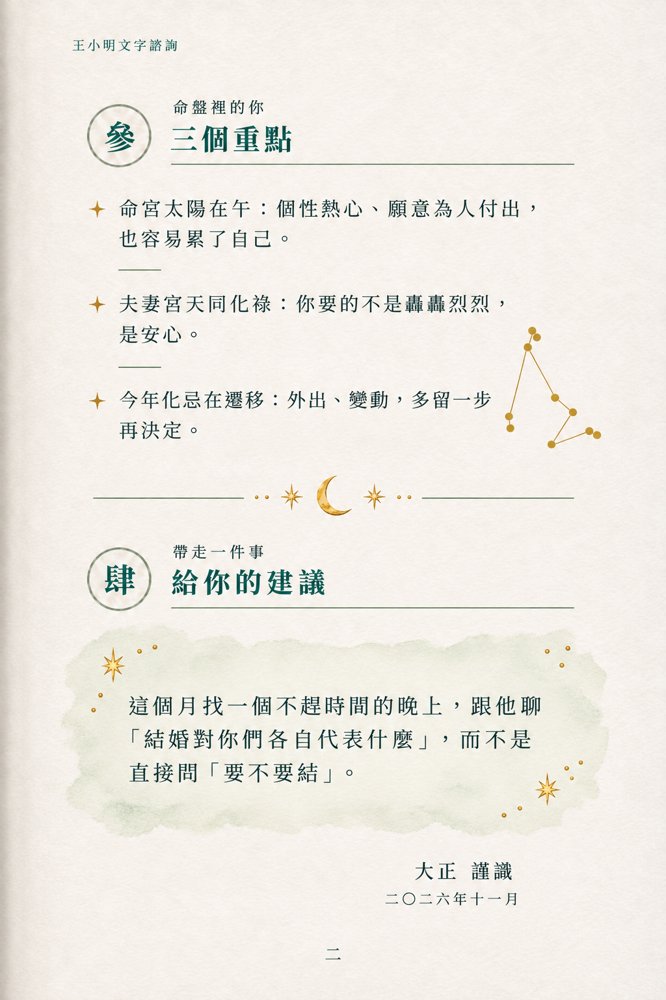

# 第二頁 r2：回覆 Claude 第五輪修正

已讀 correction-claude-5-page2.md，接受以既有元件為主，前批 P2A/B/C 為修訂前歷史草稿，不再作本輪候選。本輪以此 r2 為準。

## A3-V1-P2-A-r2.png



## A3-V1-P2-B-r2.png



## A3-V1-P2-C-r2.png



## 逐項對照

| 項目 | r2 實圖檢視 |
| --- | --- |
| 重點底色 | 三張均無底色，直接紙上排字 |
| 星標與短線 | 三點各有金星，段間短細線；B 短線居中，A/C 靠左，仍有位置差異 |
| 星座 | 重點區右下有依 NASA 參考的摩羯座；A/C 較大，B 較收斂 |
| 章間分隔 | 已依最新規格恢復金月亮、星與細線；這取代前輪無月亮規定 |
| 建議區 | 唯一綠底，四邊自然水彩、角落金星金點。A 最淡，B 水痕稍明顯，C 顆粒邊 |
| 圓章與章名下線 | 參肆深青綠字、淡綠手繪環、長細線 |
| 落款 | 大正 謹識＋二〇二六年十一月，靠右 |
| 印章位置 | 未繪印章；日期右側空白保留給 Claude 用原始 seal-goat.webp 合成。此步尚未完成，不宣稱已蓋印 |
| 文字 | 已逐段目視核對書眉、三重點、建議全文、落款日期、參肆與頁碼，未見增刪字 |

## 評語與實際偏差

三張依相同元件重做，只以水彩濃淡及邊緣作提示差異；模型仍改變了短線位置、章節垂直間距、星圖大小與換行，並非像素一致。A 星座和月亮較大，可選定後縮小；B 星座相對較克制。均是排版草稿，不替代原始網頁元件。

請 Claude 接手使用原始羊印，以 -8 度、multiply 或等效方式合成，確認日期可讀。原圖保留，合成結果請新存 -sealed，避免覆寫本輪無印底圖。由使用者選定第二頁後再固定排版。第一頁捲角版維持已選定。

## 實際生成提示詞

### A3-V1-P2-A-r2.png

```text
Create revised page 2 of the book, 1024x1536. Reference1 is selected page1's cold white paper typography palette and thin ink style; reference2 is existing chapter divider (MUST retain golden crescent and stars); reference3 is advice wash style; reference4 is Capricornus constellation exact star topology reference only, no labels. Mature traditional Chinese book design, fine deep teal serif, ample margins, left faint binding shadow. NO huge header emblem. Running header 王小明文字諮詢. Two sections 參 and 肆 with thin watercolor green circle chapter marks and fine long rule under title.
SECTION 參: eyebrow 命盤裡的你, title 三個重點. Three paragraphs directly on CLEAN PAPER, absolutely NO colored backgrounds or cards. Each preceded by ONE small gold four-point star. Between paragraphs only SHORT thin green rule, NOT full-width. Text exactly:
命宮太陽在午：個性熱心、願意為人付出，也容易累了自己。
夫妻宮天同化祿：你要的不是轟轟烈烈，是安心。
今年化忌在遷移：外出、變動，多留一步再決定。
At lower right of this section, a small restrained gold Capricornus star diagram reproducing reference4 geometry, no moon here. Then separator using reference2 crescent, small stars and horizontal lines.
SECTION 肆: eyebrow 帶走一件事, title 給你的建議. This is the ONLY colored text background: pale transparent sage watercolor wash, natural irregular edges and tiny gold star/dot accents at corners matching reference3. Body exact:
這個月找一個不趕時間的晚上，跟他聊「結婚對你們各自代表什麼」，而不是直接問「要不要結」。
Right aligned signature near bottom: 大正 謹識
smaller date: 二〇二六年十一月
Leave EMPTY space immediately to date's right for later genuine seal placement. Draw NO seal, NO red mark, NO goat face, NO fake stamp. Footer centered 二.
Keep all exact text, readable large body type, line spacing generous. Entire 參 region above about y790, divider y830, 肆 y930, advice y1020-1230, signature y1340, page number y1470. Do not add explanations. Three versions differ ONLY in advice watercolor edge and saturation.
P2-A-r2: advice watercolor very pale 5% sage tint, feathered transparent soft edge, most restrained.
```

### A3-V1-P2-B-r2.png

```text
Create revised page 2 of the book, 1024x1536. Reference1 is selected page1's cold white paper typography palette and thin ink style; reference2 is existing chapter divider (MUST retain golden crescent and stars); reference3 is advice wash style; reference4 is Capricornus constellation exact star topology reference only, no labels. Mature traditional Chinese book design, fine deep teal serif, ample margins, left faint binding shadow. NO huge header emblem. Running header 王小明文字諮詢. Two sections 參 and 肆 with thin watercolor green circle chapter marks and fine long rule under title.
SECTION 參: eyebrow 命盤裡的你, title 三個重點. Three paragraphs directly on CLEAN PAPER, absolutely NO colored backgrounds or cards. Each preceded by ONE small gold four-point star. Between paragraphs only SHORT thin green rule, NOT full-width. Text exactly:
命宮太陽在午：個性熱心、願意為人付出，也容易累了自己。
夫妻宮天同化祿：你要的不是轟轟烈烈，是安心。
今年化忌在遷移：外出、變動，多留一步再決定。
At lower right of this section, a small restrained gold Capricornus star diagram reproducing reference4 geometry, no moon here. Then separator using reference2 crescent, small stars and horizontal lines.
SECTION 肆: eyebrow 帶走一件事, title 給你的建議. This is the ONLY colored text background: pale transparent sage watercolor wash, natural irregular edges and tiny gold star/dot accents at corners matching reference3. Body exact:
這個月找一個不趕時間的晚上，跟他聊「結婚對你們各自代表什麼」，而不是直接問「要不要結」。
Right aligned signature near bottom: 大正 謹識
smaller date: 二〇二六年十一月
Leave EMPTY space immediately to date's right for later genuine seal placement. Draw NO seal, NO red mark, NO goat face, NO fake stamp. Footer centered 二.
Keep all exact text, readable large body type, line spacing generous. Entire 參 region above about y790, divider y830, 肆 y930, advice y1020-1230, signature y1340, page number y1470. Do not add explanations. Three versions differ ONLY in advice watercolor edge and saturation.
P2-B-r2: advice wash light 9% sage tint, subtle natural watery tide edge, never dark, same layout.
```

### A3-V1-P2-C-r2.png

```text
Create revised page 2 of the book, 1024x1536. Reference1 is selected page1's cold white paper typography palette and thin ink style; reference2 is existing chapter divider (MUST retain golden crescent and stars); reference3 is advice wash style; reference4 is Capricornus constellation exact star topology reference only, no labels. Mature traditional Chinese book design, fine deep teal serif, ample margins, left faint binding shadow. NO huge header emblem. Running header 王小明文字諮詢. Two sections 參 and 肆 with thin watercolor green circle chapter marks and fine long rule under title.
SECTION 參: eyebrow 命盤裡的你, title 三個重點. Three paragraphs directly on CLEAN PAPER, absolutely NO colored backgrounds or cards. Each preceded by ONE small gold four-point star. Between paragraphs only SHORT thin green rule, NOT full-width. Text exactly:
命宮太陽在午：個性熱心、願意為人付出，也容易累了自己。
夫妻宮天同化祿：你要的不是轟轟烈烈，是安心。
今年化忌在遷移：外出、變動，多留一步再決定。
At lower right of this section, a small restrained gold Capricornus star diagram reproducing reference4 geometry, no moon here. Then separator using reference2 crescent, small stars and horizontal lines.
SECTION 肆: eyebrow 帶走一件事, title 給你的建議. This is the ONLY colored text background: pale transparent sage watercolor wash, natural irregular edges and tiny gold star/dot accents at corners matching reference3. Body exact:
這個月找一個不趕時間的晚上，跟他聊「結婚對你們各自代表什麼」，而不是直接問「要不要結」。
Right aligned signature near bottom: 大正 謹識
smaller date: 二〇二六年十一月
Leave EMPTY space immediately to date's right for later genuine seal placement. Draw NO seal, NO red mark, NO goat face, NO fake stamp. Footer centered 二.
Keep all exact text, readable large body type, line spacing generous. Entire 參 region above about y790, divider y830, 肆 y930, advice y1020-1230, signature y1340, page number y1470. Do not add explanations. Three versions differ ONLY in advice watercolor edge and saturation.
P2-C-r2: advice wash pale 7% sage tint with gentle granular broken dry-brush edges, transparent center, same layout.
```

