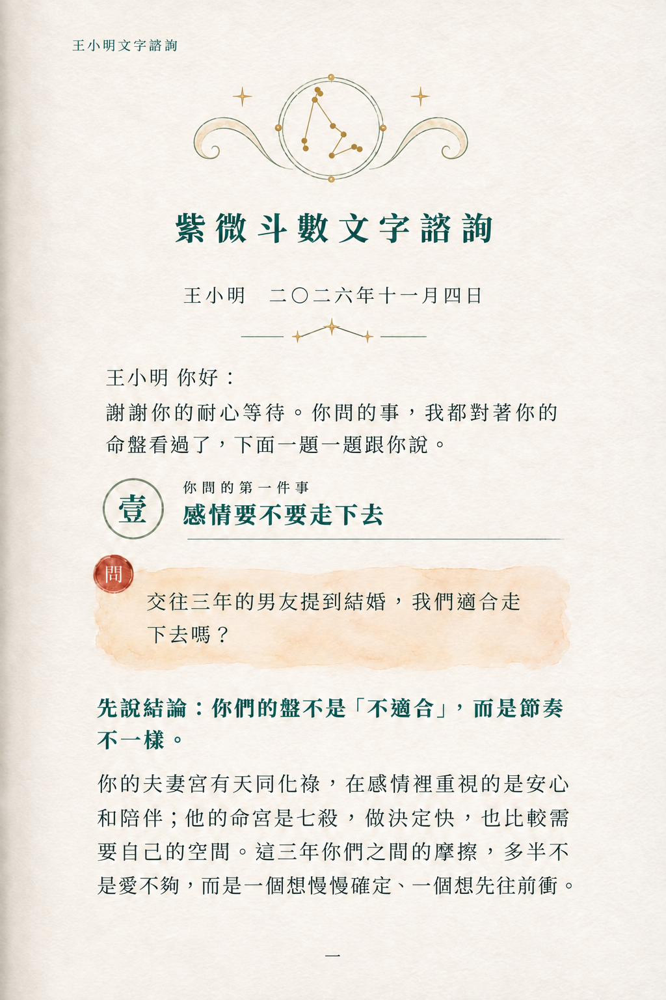
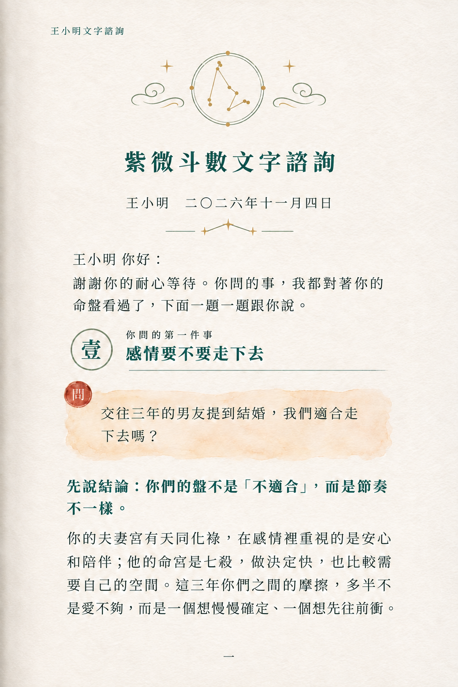
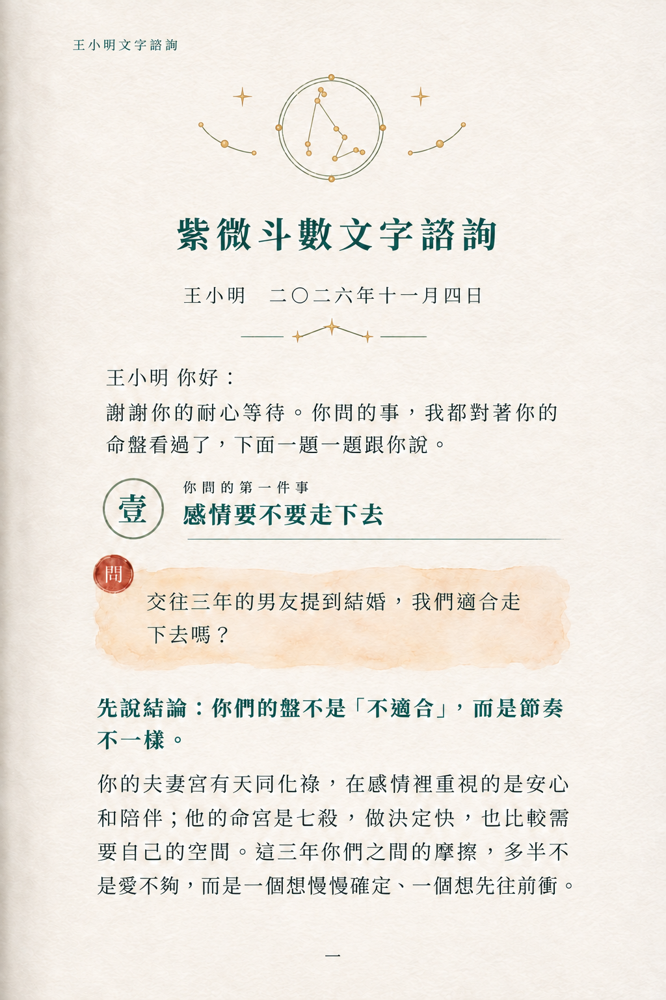

# 摩羯座三版完成與使用者偏好｜2026-11-07

## 使用者最新回覆

在依序展示 V1 捲角、V2 雲紋、V3 星軌後，使用者說「我喜歡 A 的版本」。Codex 已向使用者說明暫按本輪第一張 V1 捲角紋理解；這是依上下文的解讀，不是使用者明確說出 V1，若使用者另有指涉需修正。先保留此方向，不升為正式定稿。

## 圖片

### A3-V1-捲角紋-page1.png

### A3-V2-雲紋-page1.png

### A3-V3-星軌-page1.png

## 生成與核對

使用內建 image_gen，以 A3 原圖局部編輯。三張已視覺逐段核對：新標題「紫微斗數文字諮詢」、新書眉「王小明文字諮詢」正確；原上方小字移除。日期、問候、問題、結論、第二段正文、章節壹、頁碼一未見錯字，保留紅色問章。圖像式草稿仍非可編輯文字定稿，未宣稱像素一致。

V1：平面淡赭捲角紋。V2：青綠細線如意雲。V3：短弧星軌及小金點。均已移除葉子，保留兩側四角星和日期下方三星分隔。實際三張標題位置與字距有少量差異，後續選定版需固定。

## 摩羯座依據與差異

已下載並實際渲染檢視 NASA Constellation Printables 第 6 頁 Capricornus，將該頁作為第二張生成參考，使用原方向及分叉連線，不依先前的左右星名文字概述憑空畫扁三角。來源：https://svs.gsfc.nasa.gov/vis/a010000/a014600/a014681/Constellation_Printables.pdf

為保留來源辨識，使用約 10 個星點，與 Claude 原先 5–7 顆的簡化建議不同；採金色小點與細線而非星名、刻度或精密星圖。V3 的部分線偏青綠，與指定全金色有些差異。此為依參考製作的裝飾性星座圖徽，不宣稱天文精密比例。

## 給 Claude

請優先沿 V1 捲角版看使用者回饋，不再主推羊臉或白羊座字元。暫不動胸前徽章、其他網站標題或第二頁。下一步若獲使用者指示，建議固定 V1 圖徽與標題位置，再處理其餘頁面的共同元素。

## 實際提示詞

